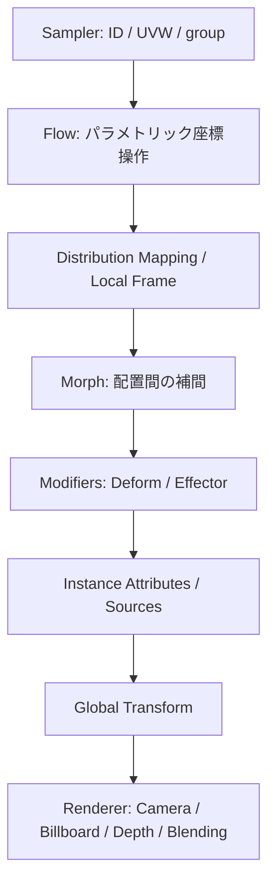
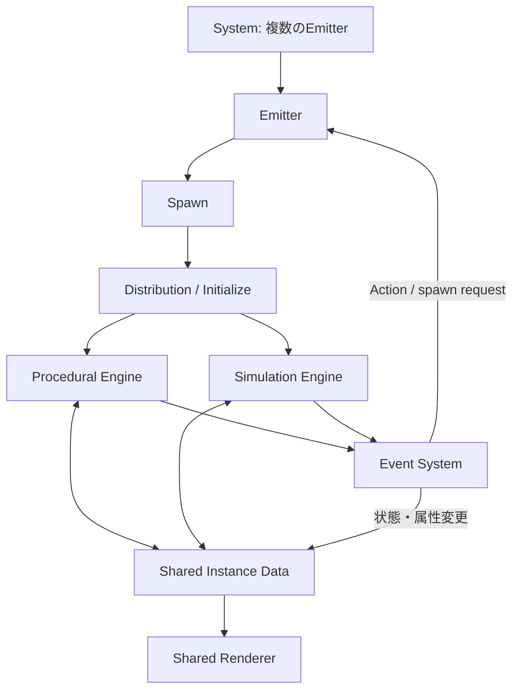
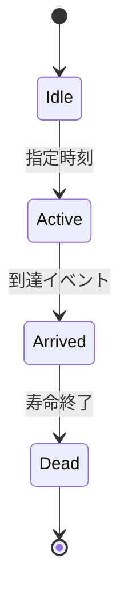
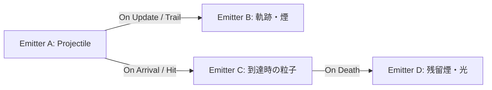

# After Effects Procedural Instance System — プロトタイプ設計仕様書

- 版：v0.1（構想・設計草案）
- 作成日：2026-11-24
- 対象：After Effects 用エフェクトプラグイン（仮称 Procedural Instance System / Duplicator）
- 想定：C++ SDK を利用する単一エフェクト内のインスタンス描画。実装方式・対応 AE バージョン・GPU バックエンドは未決定。
- 文書の目的：複製配置とイベント駆動型パーティクルに関するこれまでの会話を統合し、プロトタイプ実装および今後の議論の起点とする。

> 本書は動作するプラグインではなく設計プロトタイプ。ユーザーの要求、会話での提案、今回の補足設計を区別する。C++ は概念コードであり、AE SDK でのコンパイル・実機動作は未検証。会話内のインタラクティブな模式図は Markdown 用に表・数式・Mermaid・設定例へ置換した。参考資料の番号は本書で振り直している。

## 目次

1. [目的と設計方針](#1-目的と設計方針)
2. [全体アーキテクチャ](#2-全体アーキテクチャ)
3. [配置空間とサンプリング](#3-配置空間とサンプリング)
4. [Polar・Path・局所座標系](#4-polarpath局所座標系)
5. [インスタンスデータ](#5-インスタンスデータ)
6. [モディファイア](#6-モディファイア)
7. [Flow・ループ移動](#7-flowループ移動)
8. [配置間のMorph](#8-配置間のmorph)
9. [素材・選択・タイムサンプリング](#9-素材選択タイムサンプリング)
10. [Emitterとライフサイクル](#10-emitterとライフサイクル)
11. [イベント・状態遷移・スクリプト](#11-イベント状態遷移スクリプト)
12. [プロジェクタイル演出](#12-プロジェクタイル演出)
13. [時間評価とキャッシュ](#13-時間評価とキャッシュ)
14. [追加機能・応用例](#14-追加機能応用例)
15. [AE UI設計](#15-ae-ui設計)
16. [AE SDK・描画・技術検証](#16-ae-sdk描画技術検証)
17. [実装ロードマップと受入基準](#17-実装ロードマップと受入基準)
18. [未決事項](#18-未決事項)
19. [参考資料](#19-参考資料)
20. [付録：ユーザーの原文](#20-付録ユーザーの原文)

## 1. 目的と設計方針

### 1.1 製品の方向性

Trapcode Form + Furikake + PathRepeater を統合したようなプラグインを土台とし、Cavalry の Behaviour / Falloff / Context のような手続き型の属性制御を採り入れる。さらに、ゲームの VFX に見られるプロジェクタイル、追従する素材、到達時の別エミッター起動を扱えるようにする。

単なるレイヤー複製ツールではなく、**複製物の集合を生成し、配置・変形・時間発展・イベントを共通の仕組みで制御する手続き型インスタンスシステム**を目指す。複製物は原則として AE の個別レイヤーを大量に生成せず、エフェクト内の論理インスタンスとして描画する（提案）。

通常の複製配置では、複製数とトポロジーが安定した表現を優先する。パーティクルでは生成・消滅・寿命・状態変化を扱う。両者は共通 ID、属性、素材、モディファイア、レンダラーを利用するが、評価方式まで無理に一体化しない。

### 1.2 設計原則

- 配置モードは位置・パラメトリック座標・局所方向・グループなどを返し、波形やノイズ等を個別実装しない。
- 格子を直接万能化するのではなく、Sampler / Mapping / Frame を分離して共通化する。
- モディファイアは値の生成、参照ドメイン、適用範囲、対象属性、適用座標系を分離する。
- 時間から直接評価できる表現を優先し、履歴が必要なもののみシミュレーションにする。
- イベントは時間評価方式から独立させる。イベント機能があること自体は逐次シミュレーションを意味しない。
- スクリプトなしで日常的な演出を作れるようにし、特殊な拡張にのみ Expression / DSL / スクリプトを検討する。
- AE の任意フレーム評価と Multi-Frame Rendering (MFR) を前提とする。
- ID と描画順・配列 Index を分離し、Seed と安定した ID によって再現性を確保する。
- 内部は 3D を基本とし、2D は Z=0 のケースとして扱う。

### 1.3 参考製品との関係

| 参考 | 着想・確認事項 |
|---|---|
| GetColor-V2R | 格子状配置の着想。AviUtl 系資料 [R22] を確認。詳細な配置仕様は未確認。 |
| Trapcode Form | Base Form を基準に Layer Maps・変位等を適用する構造 [R1–R4]。 |
| Furikake | AE 用パーティクル、素材を用いた粒子演出の着想 [R5]。 |
| PathRepeater | パス上の素材反復・経路制御の着想。製品名に対応する詳細な一次資料は未確認。 |
| Cavalry | Duplicator、Index Context、Behaviour、Falloff、時間差制御 [R6–R10]。 |
| Niagara | Spawn / Update / Event Handler とモジュールスタック、エミッター間イベント [R11–R13]。 |
| Unity Visual Effect Graph | Spawn / Initialize / Update、イベント・GPU Event [R14]。 |
| Houdini POP | 粒子ソース、状態更新、衝突時の処理 [R15–R16]。 |
| Trapcode Particular | ライフサイクルを持つパーティクルの比較対象。Form と固定配置・発生型表現の境界をなくすことが目的。 |

## 2. 全体アーキテクチャ

### 2.1 配置中心の基本パイプライン



会話の初期案では Distribution → Morph → Modifiers → Instance Attributes → Global Transform → Renderer の順序だった。Flow は Mapping の前に適用する処理として追記した。Morph A/B が別々の Flow を持つかどうかは仕様未決定。通常の素材選択や時間属性の更新は描画前に解決する。

### 2.2 Emitter を含めた拡張構造



実際の処理は一方向の図だけではなく、各エンジンと属性・イベントが相互にデータを交換する。ただし描画中に AE のプロジェクトや別エフェクトを変更するのではなく、エフェクト内部の論理イベントとして処理する。

| 区分 | 役割 | 例 |
|---|---|---|
| Distribution | 基準配置・発生位置 | Grid / Polar / Path |
| Flow | 配置空間内の移動 | Loop / Phase / Offset |
| Deformer | 実空間の変形 | Wave / Noise / Twist |
| Effector | 属性操作 | Scale / Color / Source / Time |
| Behaviour | 時間的挙動 | Follow / Delay / Return |
| Condition | 条件評価 | Age / Distance / Region |
| Action | イベントへの応答 | Spawn / Kill / Set State |
| Renderer | 最終描画 | Billboard / Depth Sorting / Blend |

Flow・Deform・Effector が元の複製配置の3本柱。Behaviour・Condition・Action は動的な演出に必要な拡張であり、通常の複製用途では隠せる。

## 3. 配置空間とサンプリング

### 3.1 格子状配置の一般化

各点を整数インデックス `i,j,k` と正規化パラメーター `u,v,w` で表現する。直交座標以外に角度、半径、緯度、経路上の進行度などとして解釈する。

```cpp
int i, j, k;
float u, v, w; // 正規化された座標
```

| 配置モード | U | V | W |
|---|---|---|---|
| Grid | X | Y | Z |
| Circle / Concentric | 角度 | 半径 | 高さ |
| Radial | 半径 | 角度 | 高さ |
| Cylinder | 角度 | 高さ | 半径 |
| Sphere | 経度 | 緯度 | 半径 |
| Path / Line | 進行度 | 横方向 | 奥行き |
| Polygon | 周上進行度 | 半径 | 高さ |
| Spiral | 進行度 | アーム番号 | 高さ |
| Polyhedron | 面内座標 | 面内座標 | 層など（faceID は別属性） |

円形・放射状は同じ Polar Mapping のサンプル列の解釈違い。ここでは会話の U/V の意味を残したが、内部の Polar の軸規約は角度 U・半径 V に統一するか、明示的な軸変換を設ける（補足案）。格子と同じ ID 構造の点を別の Mapping に渡すと、同心円、放射、螺旋、円筒、複数列パスへ変換できる。

### 3.2 Sampler / Mapping / Frame

- Sampler：サンプル数とそのパラメトリック座標、整数軸番号・グループ・ID を決める。
- Mapping：パラメトリック座標を 3D の実空間座標に変換する。
- Frame：座標における接線・法線・軸方向・基準点を返す。

```cpp
// 概念インターフェース。型は仮定義。
struct Sample { uint64_t id; int3 gridIndex; float3 uvw; int groupID; };
struct Frame { float3 tangent, normal, binormal, pivot; };
struct MappedPoint { float3 position; Frame frame; };
// Sampler.generate(settings, seed) -> samples
// Mapping.evaluate(sample, time, settings) -> MappedPoint
```

追加モードは共通出力を満たせば既存のモディファイアを利用できる。逆にモディファイアを一つ追加すれば全配置モードで使えることを目指す。

ただし、球面の極で点が密集する問題、多面体の各面の面積差、パスの弧長による密度などは単純な座標変換だけで解決できない。Sampler を Mapping の性質に応じて切り替える。球面の等面積サンプリング、面積重み付き三角形サンプリング等を追加候補とする。閉曲線では終点と始点を二重生成しない。中心・極・ゼロ長パスでは Frame のフォールバックが必要。

### 3.3 ランダム配置と密集の抑制

| 方式 | 概要 | 制約 |
|---|---|---|
| Uniform Random | 独立な一様乱数でサンプリング | 自然な密集が発生する |
| Jittered Grid | 各セル内でランダムに変位 | 格子構造を保ちやすいが最小距離保証ではない |
| Poisson Disk | 点間の最小距離を満たす分布 | 指定数と最小距離を同時に満たせないことがある |
| Fibonacci | 黄金角等を使う球面・円盤分布 | 均等分散の近似。Poisson Disk そのものではない |
| Density Map | 画像の明暗等に応じて密度を変える | マップの更新・時間評価・総数制約が必要 |

初期実装は Jittered Grid。Poisson Disk は指定数優先 / 距離優先を決める。距離保証はサンプル空間と実空間で異なるため、最小距離の定義を指定する。点間隔と描画素材同士の非重複は別問題であり、後者は素材サイズ・向き・投影まで関係する。

## 4. Polar・Path・局所座標系

### 4.1 Polar Mapping

円形・同心円・放射状・螺旋を統合する。角度に半径依存のオフセットを加える。

```text
x = r * cos(theta + tau * r)
y = r * sin(theta + tau * r)
z = height
```

`tau` は半径単位あたりのねじれ。UI では内側から外側への総ねじれ角（Twist）を指定できるようにする案。

| パラメーター | 意味 |
|---|---|
| Angular Count / Arms | 円周方向の点数、放射方向の本数 |
| Radial Count / Rings | 同心円の層数、半径方向の点数 |
| Inner / Outer Radius | 内外半径 |
| Angular Range / Phase | 角度範囲、初期位相 |
| Twist | 半径依存の角度オフセット |
| Height / Layers | 高さ方向の層 |

会話中の模式例：円形 = 24 arms × 1 ring、放射状 = 7 arms × 9 rings、螺旋 = 同じ 7×9 に Twist 240°。複製数は基本的に Arms × Rings × Layers。半径ゼロの点は重複を許すか統合するか未決定。

半径方向の周期的な Scale / Opacity による同心円縞、リングの拡大・収縮ループ、角度方向への公転、半径依存の回転速度による渦巻き、波打つリング、円筒方向の移動、グループ単位の位相差などが自然に派生する。

多角形の周上・内部配置、多面体の頂点・辺・面、球面・球体・球殻、円筒の表面・内部・層なども拡張可能。各モードの点密度やグループ構造は別途定義する。

### 4.2 Path / Line Mapping

一列配置は直線パスとして、複数列は接線に垂直な方向へのオフセットとして扱える。任意の曲線でパス上の位置と向きを評価する。

```text
P(u,v,w) = Curve(u) + OffsetV(v) * N(u) + OffsetW(w) * B(u)
```

- U：進行度。弧長正規化により等間隔・等速移動が可能（補足案）。
- V/W：横方向・奥行き。複数列・帯状・チューブ状など。
- 連続移動と離散移動：Phase を連続値で評価するか、点間隔・ステップ数で量子化するか選択。
- 開いたパスと閉じたパス、始点・終点、反転、Wrap / Ping Pong / Clamp / Discard を扱う。
- 放射状配置は直線の複数列を中心の周囲に回転配置するものとしても理解できる。

AE の `PF_Param_PATH` はエフェクト適用先レイヤーのマスクを参照する制約がある。任意のシェイプレイヤーのパスを同等に扱えるとは限らない [R20]。

### 4.3 局所フレームとピボット

方向は単一ベクトルではなく複数軸を持つ。中心点（pivot）も回転、拡縮、距離効果に利用するため残す。

| 配置 | 局所方向 | 基準点・注意点 |
|---|---|---|
| Grid | X/Y/Z、平面法線 | 配置中心、セル中心など |
| Polar | 半径方向、円周接線、高さ方向 | 円の中心またはリング固有のピボット |
| Path | 接線 T、法線 N、従法線 B | パス上の基準位置 |
| Sphere | 表面法線、接線2軸 | 球の中心。極で接線の特異点に注意 |
| Random | 既定軸、指定方向または Mapping の Frame | 分布中心など |

同じ Normal Offset でも、円形では半径方向の変位、パスでは左右の揺れ、球面では隆起、平面格子では高さ方向の波となる。Frame の軸規約は統一する。3D パスでは曲率ゼロで不安定になり得る Frenet Frame に代わり、平行移動フレーム等も検討する（補足案）。

なお、接線方向の平行移動と、角度や進行度そのものの変更は別の操作である。前者は円周や曲線から外れ、後者は経路に沿って移動する。

## 5. インスタンスデータ

会話の初期案の Instance 構造を、Emitter と状態遷移に対応できるように統合する。

```cpp
struct Instance {
    uint64_t id;
    int index;
    int3 gridIndex;
    int groupID;
    float3 uvw;
    float3 basePosition;
    float3 position;
    float3 tangent, normal, binormal;
    float3 pivot;
    quaternion rotation;
    float3 scale;
    float4 color;
    float opacity;
    int sourceIndex;
    float timeOffset;
    float random;

    // Emitter / Lifecycle 拡張
    uint64_t emitterID;
    uint64_t parentID;
    float3 velocity;
    double birthTime;
    float lifetime;
    int state;
    bool alive;
};
```

`age = time - birthTime`、`normalizedAge = age / lifetime` は評価時に導出できる。寿命無限・ゼロの扱いを別途定義する。ベース座標、現在座標、描画座標を混同しない。Local Frame と素材自身の回転は独立した属性とする。任意属性の追加は初期は固定スキーマ、後期に Custom Attributes を検討。

ID は配列順序や深度ソートと独立させる。乱数は `hash(seed, emitterID, instanceID, channel)` のような決定論的な仕組みで各属性用に生成する（補足案）。Count やトポロジー変更時に既存 ID を維持する範囲は仕様化が必要。派生インスタンスは親 ID、イベント ID、発生順等から一意な ID を生成する案。

大量の点には、実装時に AoS / SoA のメモリ構造を比較する。概念コードの全属性を全インスタンスに必ず保持する必要はない。

## 6. モディファイア

### 6.1 Generator / Domain / Target

各モディファイアを Generator（値の生成）、Domain（入力）、Falloff / Selection（影響範囲）、Target（対象）、Space（座標空間）、Blend（合成演算）に分割する。

| 要素 | 候補 |
|---|---|
| Generator | Constant, Linear/Stagger, Sine/Oscillator, Random, Noise, Image Map, Custom Curve |
| Domain | Index, ID, U/V/W, Position, Distance, Angle, Group, Time, Age, State, Custom Attribute |
| Falloff / Mask | 距離、円・矩形・球、画像、範囲、選択条件 |
| Target | Position, Rotation, Scale, Opacity, Color, Source Index, Time Offset, U/V/W, Morph Progress |
| Blend | Add, Multiply, Replace, Lerp 等（補足案） |
| Strength | 強度・重み |

例：同じ Sine を別の Domain・Target に接続する。

| Generator | Domain | Target | 結果 |
|---|---|---|---|
| Sine | U | Position | 波状配置 |
| Sine | V | Scale | 同心円状の大小変化 |
| Sine | Distance | Opacity | 同心円縞 |
| Random | ID | Source Index | 素材のランダム選択 |
| Noise | Position | Rotation | 空間的に連続した回転 |
| Linear | Index | Time Offset | 順番にアニメーション |
| Image Map | UV | Scale | 画像の明暗によるサイズ変更 |
| Image Map | Position | Position Z | 画像による立体的凹凸 |

Cavalry の Context / Behaviour / Falloff と Trapcode Form の Layer Maps が参考となる [R1–R3, R6–R10]。

### 6.2 適用座標空間

| Space | 意味 |
|---|---|
| Parametric | 配置座標 U/V/W。Mapping 前に評価。 |
| Instance Local | 配置の局所フレームを使った変位等。素材のローカル座標との区別は明示する。 |
| Distribution | 配置全体のローカル空間 |
| World | 3D シーン空間 |
| Screen | カメラ投影後の画面空間 |

局所変位は `P + d*T` のような実空間上の操作。Parametric Offset は `Mapping(u + delta, v, w)` のような経路上の操作。この差をUIで明示する。

### 6.3 評価順序と適用範囲

Wave、Noise、Twist、Offset、Map 等を任意順序で積み重ねる。変形前の位置を参照するか、直前の結果を参照するかを選べると有用。Morph Progress のモディファイアは Morph 前、UVW を変更するものは Mapping 前、Screen 操作は投影以降で処理する。全モディファイアを自由な位置に置けるとは限らず、ステージや依存関係の検証が必要（補足案）。

Falloff / Field は空間的な影響度を 0〜1 等で返す。Selection は特定インデックス・グループ・状態・範囲などに限定する。全体変形 Global Transform は個別モディファイアと分離する。

## 7. Flow・ループ移動

```cpp
u = fract(u + time * speed);
// fract(x) = x - floor(x)
```

格子なら範囲内を横断、パスなら経路上を移動、円形なら公転、多重リングなら半径方向を繰り返し移動する。固定 ID による乱数で速度・位相を変える。グループごとの移動も可能にする。

| Boundary | 動作 |
|---|---|
| Wrap | 端から反対側へ移動 |
| Ping Pong | 端で反転、往復 |
| Clamp | 端で停止 |
| Discard | 範囲外で非表示 |

開いたパスや格子の Wrap は位置が不連続になるため、境界でのフェードやクリップの選択を検討する。閉じたパスは継ぎ目の向きも連続させる。

速度をキーフレーム化する場合、`time * speed(time)` は物理的な累積移動ではなく不連続・逆行を生むことがある。Phase を直接キーフレーム化するか、速度を積分して累積移動量を求める。離散移動は Phase をステップ量子化する。これらは履歴キャッシュなしで表現できる場合が多い。

## 8. 配置間のMorph

Distribution A と B で同じ ID に対応する位置を生成し、Morph Progress `b` で補間する。

```text
P_i = (1-b)*P_A_i + b*P_B_i
```

例えば 60 個の格子点（12×5）を同心円、螺旋、球面へ移行させる。同一 ID を維持することで色や素材・時間オフセットも連続する。

| Matching | 内容 |
|---|---|
| Index | 同じ要素番号同士（初期実装） |
| UVW | パラメトリック座標を基準に対応 |
| Nearest | 近傍を基準に一対一で対応。単純な最近傍だけでは多対一になるため割当処理が必要。 |
| Random | Seed による一対一のランダム順序 |
| Optimal | 全体の移動距離等のコストを最小化する割当 |

位置に加え Frame / Rotation を補間する。3D 回転は Quaternion の SLERP 等を利用する。離散属性（素材、状態、グループ）は切り替え規則を決め、数値属性と同じ線形補間をしない。Morph Progress 自体を Stagger、Noise、Falloff で個別にずらし、左から右へ順に変形したりランダムに移行したりできるようにする。

初期は複製数が同じ場合に限定。異なる数では対応しない要素の出現・消滅・スケール・透明度、ID の扱いを設計する。毎フレーム対応付けを再計算して不連続になる問題も考慮する。

## 9. 素材・選択・タイムサンプリング

### 9.1 複数素材

| Assignment | 例 |
|---|---|
| Sequential | A B C A B C |
| Random | A C C B A C |
| Weighted Random | A 70%、B 20%、C 10% |
| By Group | リングごとに異なる素材 |
| By Axis | 行・列ごとに素材を変える |
| By Map | マップの輝度等で素材選択 |
| Manual | 指定 ID のみ素材を上書き |

素材画像は AE の参照レイヤー等から取得する。素材番号指定は離散値として範囲チェックする。参照レイヤー欠損時の扱いも定義する。

### 9.2 Selection / Override

```text
Index = 10
Index = 10～20
Index % 2 = 0
Group = 3
U = 0.25～0.75
Random < 0.3
State = 1
```

Selection を各モディファイアや Action に適用できる共通機能とする。素材変更だけでも初期要求を満たすが、Scale / Rotation / Color / Time / State 等に拡張できる。Index は0始まりか1始まりかを内部とUIで明記する（未決定）。

### 9.3 時間の種類

| 時間 | 役割 |
|---|---|
| Global Time | コンポジションの時間 |
| Instance Time | インスタンスのモディファイアの評価時間 |
| Source Time | 素材画像の取得時刻 |
| Age | 生成からの経過時間 |

Source Time だけをずらせば動画素材の時間差、Instance Time だけをずらせばモディファイアの時間差になる。Time Offset、Time Scale、Time Quantization、Freeze / Loop / Clamp を候補とする。ランダムな登場は固定 ID に開始時刻を割り当て、透明度やスケールで表示を変える方法と、真の Spawn を区別する。

1万個の複製物が異なる時刻の画像を要求すると素材取得がボトルネックとなる。Source Index とサンプル時刻（実際には参照レイヤー、品質、必要領域等も含む）の組で取得を共有し、時刻をフレーム単位または指定ステップ単位で量子化できるようにする。

## 10. Emitterとライフサイクル

Distribution を上位の Emitter に組み込み、いつ・どこに・何を発生させるかを管理する。Spawn・Distribution・Initialize・Update・Event・Render の段階を設ける。Niagara の段階別モジュールスタックや Unity VFX Graph、Houdini POP が参考 [R11–R16]。

| 段階 | 役割 |
|---|---|
| Spawn | 発生時刻、数、条件、発生要求の処理 |
| Distribution | 現在の基準配置または発生時の初期位置 |
| Initialize | 初期素材、属性、寿命、状態等 |
| Update | 移動、追従、変形、属性の更新 |
| Event | 条件判定、状態変化、別 Emitter の起動 |
| Render | 共通レンダラーで描画 |

| 項目 | 通常の複製配置 | パーティクル |
|---|---|---|
| Spawn | 最初から全要素が存在 | 時刻・イベントに応じて発生 |
| Distribution | 現在の基準位置 | 発生時の初期位置、または参照用基準位置 |
| Lifetime | 無限・表示期間 | 有限 |
| Update | モディファイアで変形 | 経過時間に応じた運動・属性更新 |
| Event | なくても成立 | Birth / Arrival / Death 等 |
| Render | 共通 | 共通 |

Spawn Mode の候補（補足）：Static / Timed Burst / Continuous / Receive Event。マーカーや外部属性からの発生は将来候補。各インスタンスの発生時刻と寿命を独立に持たせる。固定配置と履歴依存の運動を切り替えたり、元の配置を参照し続けたりできるようにする。

## 11. イベント・状態遷移・スクリプト

### 11.1 Event-Condition-Action (ECA)

スクリプトを必須とせず、Trigger（いつ評価するか）、Condition（何を条件とするか）、Action（何を行うか）を組み合わせる。イベント駆動型パーティクルシステムおよびステートマシンの考え方を利用する。

| Trigger | Condition | Action |
|---|---|---|
| On Birth | 年齢、経過時間 | Spawn |
| On Update | 距離、速度 | Kill |
| On Death | 要素番号、ID、グループ | Set Attribute |
| On Enter | 領域への進入 | Change Source |
| On Exit | 領域からの退出 | Change State |
| On Timer | 属性値、確率 | Send Event |
| On Arrival / On Hit | 指定した到達条件 | 複数 Action を順に実行 |

表の各列は候補の独立した一覧であり、同じ行の要素に限定した組み合わせではない。条件の AND / OR、Once per Instance / Repeat / Cooldown は拡張候補。条件が成立している間の毎回発火と、未成立から成立への変化時に一度だけ発火する動作を区別する。

### 11.2 Event Payload

イベントの発生位置・時刻・素材属性などを派生 Emitter に継承できるようにする。

```cpp
struct EventPayload {
    EventType type;
    uint64_t instanceID;
    uint64_t emitterID;
    double time;
    float3 position;
    float3 velocity;
    float3 normal;
    float4 color;
};
```

例：親インスタンスの消滅位置から別の粒子を生成する、親の色を継承する、発生位置を起点に円形配置を作る。イベント ID や親 ID、ユーザー属性の継承を後から追加可能にする。

補足設計：同時刻のイベントの処理順を固定し、再評価で重複発生しないようにする。循環的な Emitter 接続、同一時刻の無限連鎖、生成数の爆発を防止するため、最大派生深度・最大イベント数・最大インスタンス数を設ける。イベントは AE プロジェクトを変更する外部副作用ではなく、評価結果内のデータとして扱う。

### 11.3 ステートマシン



| State | Behaviour |
|---|---|
| Idle | 初期配置で待機 |
| Active | 移動・追従等の Behaviour を有効化 |
| Arrived | イベント発行、素材変更等 |
| Dead | 描画対象から除外 |

各 State に対して有効な Behaviour を切り替える。最初は完全なステートマシンエディターを用意せず、整数 `state` 属性と Selection、Change State Action で簡易状態機械を構成する。

応用：格子から順次飛び出す、飛散後に再集合する、領域に入ったものだけ形や色を変える、一定時間後に分裂する、文字を構成する点が別の文字へ移る。

### 11.4 スクリプト機能の位置付け

| 方式 | 自由度 | 実装コスト |
|---|---|---|
| 専用パラメーター | 低い | 低い |
| Behaviour Stack | 高い | 中程度 |
| ノードベース | 非常に高い | 高い |
| スクリプト | 非常に高い | 言語・実行基盤が必要 |

初期は Behaviour Stack を推奨する。内部のモジュール定義は型付きグラフや命令列へ変換できる構造にしておき、将来ノードエディターを追加可能にする。スクリプトは最後の拡張手段。AE の Expression（AE パラメーター制御）、プロジェクト操作用スクリプト、プラグイン内部のインスタンス単位 Expression / DSL を混同しない。内部 DSL を導入する場合は評価コスト、決定論、権限、エラー表示、ループや実行時間の上限等が必要（補足案）。

## 12. プロジェクタイル演出

### 12.1 想定ユースケース

ゲーム風のミサイル・魔法弾・誘導する光点などを After Effects の映像演出として表現する。特定の時刻に現れ、指定位置やレイヤーに向かって移動し、到達演出を起点に別の粒子を生成する。煙・光跡・残留エフェクトも同一システムで作る。実世界の誘導装置ではなく映像内の仮想オブジェクトを対象とする。



### 12.2 設定例

```yaml
# 将来のデータ表現の一例。実行できる形式ではない。
system:
  emitters:
    - name: Projectile
      spawn: { mode: TimedBurst, time: 1.0, count: 1 }
      distribution: { type: Point }
      lifetime: { mode: UntilArrival, maximum: 5.0 }
      behaviours:
        - { type: MoveToTarget, target: TargetLayer, mode: TimeDriven, arrivalTime: 3.0 }
        - { type: OrientToMotion }
      events:
        - trigger: OnUpdate
          action: { type: SendEvent, name: Trail, rate: 12 }
        - trigger: OnArrival
          repeat: OncePerInstance
          actions:
            - { type: Spawn, emitter: ArrivalFX, inherit: [position, color] }
            - { type: ChangeState, state: Arrived }
            - { type: Kill }
    - name: TrailFX
      spawn: { mode: ReceiveEvent, event: Trail }
      lifetime: 0.6
      behaviours: [FadeOut]
    - name: ArrivalFX
      spawn: { mode: ReceiveEvent }
      distribution: { type: Random }
      lifetime: 1.0
      behaviours: [Expand, FadeOut]
      events:
        - trigger: OnDeath
          action: { type: Spawn, emitter: ResidualFX, inherit: [position] }
    - name: ResidualFX
      spawn: { mode: ReceiveEvent }
      lifetime: 1.5
      behaviours: [FadeOut]
```

数値は UI の説明用で、演出速度・粒子数の仕様を固定するものではない。Kill と Arrived の両方を使用すると Arrived 状態で描画される期間がなくなるため、到達後も素材を残したい場合は Kill を遅らせる。Trail は評価フレームごとではなく指定時間間隔または距離間隔で発生させる設計とし、フレームレートによる結果の変化を抑える（補足案）。

### 12.3 Time Driven と Simulation Driven

| | Time Driven | Simulation Driven |
|---|---|---|
| 制御基準 | 到達時刻・進行度 | 履歴依存の状態更新 |
| 到達時刻 | ユーザーが指定 | 計算結果によって決まる |
| タイムライン操作 | 直接評価しやすい | 再計算・キャッシュが必要 |
| 用途 | ビートやカットに合わせる、意図した演出 | 動的な追従・相互作用を持つ演出 |

映像用途では Time Driven を優先する。指定時刻に対象レイヤーの位置へ到達させ、カーブ・イージングで見た目の軌道を調整し、到達時刻を派生 Emitter の発生時刻にできる。対象の位置を現在時刻で評価するか、到達時刻で評価するかは選択可能にする案。見た目の追従と真の履歴依存追従は別モードとする。実装には参照レイヤーの時間・変換情報の取得が必要。

### 12.4 イベント UI の例

```text
Event 01 — 到達時の演出
├─ Trigger   : On Enter / On Arrival
├─ Condition : Target Region
├─ Target    : Target Layer
├─ Repeat    : Once per Instance
└─ Actions
   ├─ Spawn Emitter : ArrivalFX / Inherit Position
   ├─ Change State  : Arrived
   └─ Kill Instance : optional
```

Target は位置、レイヤー、あるいは演出上の領域として抽象化する。On Enter / On Exit と On Arrival を区別し、対象が存在しない場合や参照が切れた場合の挙動を定義する。

## 13. 時間評価とキャッシュ

### 13.1 AE とゲームの違い

ゲームでは通常 F0 → F1 → F2 → F3 → F4 と時間順に評価する。AE では F0 → F120 → F24 → F121 → F8 のように任意順に要求され得る。MFR では複数フレームが同時に評価される。前回レンダリングしたフレームの状態を前提にしてはならない [R17–R19]。

### 13.2 Analytical / Procedural 評価

現在の時刻、ID、Seed、パラメーターから直接状態を決める。

- Grid / Polar / Path 等の配置、Morph、周期ループ。
- Wave / Noise / Stagger、指定時刻の表示開始・終了。
- 指定時間での移動、予め時刻が決まっているイベントとその派生粒子。

時刻が確定した派生イベントは直接評価できる。例えば到達時刻 `t_event` と寿命が分かれば、派生インスタンスは `t - t_event` の関数として描画できる。過去フレームを逐次レンダリングする必要はない。これをプロトタイプの優先方式にする。

### 13.3 Simulation 評価

履歴依存の移動、動的な追従、衝突・到達判定、複製物間の相互作用、条件による動的な発生には状態の更新が必要な場合がある。開始時刻から再計算するか、有効な Checkpoint から再開する。

```text
F0       F8       F16      F24
[C]------[C]------[C]------[C]------> 時間
                  |----> F23 (要求時刻)
                  有効な F16 の状態から再評価
```

固定時間ステップ、イベントの安定した順序、乱数の決定論的な生成、途中時刻のサンプリング、依存パラメーターの取得を設計する（補足案）。MFR 対応では共有する Checkpoint を不変データとして扱うなど、スレッド安全性を確保する。複数スレッドが同じ計算を要求するケースも検証する。

### 13.4 キャッシュ無効化

AE SDK の Compute Cache とパラメーター状態の比較 API (`PF_GetCurrentState` / `PF_AreStatesIdentical`) が候補 [R17–R19]。Compute Cache はプロジェクトに永続保存されるものではない。キャッシュが消えても再計算で同じ結果を得られることが前提。

キーや依存関係にはエフェクトの識別子、設定バージョン、Seed、評価開始時刻、時間刻み、Emitter 接続、参照レイヤーと過去時刻の属性、素材画像、パス、カメラ等を必要に応じ含める。単に現在時刻のパラメーターだけでは、過去の変更を検出できない。履歴依存部分への変更時は、影響を受ける最初の時刻以降の Checkpoint を破棄する。正確な依存関係の取得・キャッシュ無効化が AE SDK 上で実現可能かは早期検証事項。

## 14. 追加機能・応用例

| 機能 | 概要・表現 |
|---|---|
| Falloff / Field | 円、矩形、球、距離による影響範囲。移動するフィールドで順次変形。 |
| Stagger / Group Offset | 行・列・リング単位のオフセット、千鳥格子、レンガ状配置、交互回転。 |
| Look At / Target | 指定点・レイヤー・中心・移動方向・カメラに向ける。 |
| Nested Distribution | 円周上の各点に円形配置、格子点から放射状、パス上にリング等。複製数が乗算的に増える。 |
| Distribution Mask | 画像のアルファ、輝度、マスクパス等で分布を制限。文字の内部を埋める。 |
| Trail Emitter | 移動履歴に沿って残像や軌跡を生成。 |
| Sub Emitter | 発生、消滅、状態変化を起点に別の集合を生成。 |
| Event Field | フィールドの進入・退出で状態変更。Falloff のイベント版。 |
| Return to Distribution | 自由移動したインスタンスを元の格子・円形・パス等へ戻す。 |

Return to Distribution は、保持した ID と基準座標を使って再集合させる、複製配置とパーティクルの統合を活かす機能。これ自体が他製品に存在しないと断定するものではない。

その他のユースケース：画像マップで立体的な点群、タイムオフセットした素材の格子、順次出現する文字、回転しながら移動するリング、螺旋状の流れ、グループごとに素材や速度が変わる動的配置、配置モード間の段階的なモーフィング。

## 15. AE UI設計

### 15.1 標準 Effect Controls

```text
Duplicator / Procedural Instance System
├─ Distribution
│  ├─ Type
│  ├─ Count U / V / W
│  ├─ Size / Spacing
│  ├─ Sampling Method
│  └─ Distribution Settings
├─ Morph
│  ├─ Enable / Target Distribution / Progress
│  └─ Matching Method / Stagger
├─ Sources
│  ├─ Source 1 ... N / Assignment Method
│  └─ Time Sampling / Offset / Quantization
├─ Modifiers
│  └─ Modifier 01 / 02 / 03 / 04 / ...
├─ Selection / Override
│  ├─ Selection Mode / Index / Range / Group
│  └─ Attribute Overrides
├─ Global Transform
│  └─ Position / Rotation / Scale / Pivot
├─ Rendering
│  └─ Orientation / Billboard / Camera / Depth Sorting / Motion Blur / Blend Mode
└─ Advanced
   └─ Random Seed / Quality / Cache / Sampling Limits
```

各 Modifier スロット例：

```text
Modifier 01
├─ Enable
├─ Generator : Sine
├─ Domain    : U
├─ Target    : Position
├─ Space     : Instance Local
├─ Direction : Normal
├─ Blend     : Add
├─ Strength  : 100%
├─ Frequency : 3
├─ Phase     : 0°
├─ Evolution : 0°
└─ Falloff
```

固定数のスロットと関連するパラメーターの表示切替で初期実装。可変長のモジュールや複数 Emitter を扱う場合は専用 Designer を検討する。モジュールの順序変更・追加・削除・複製、プリセット、Undo、保存形式のバージョン管理も必要（補足案）。

### 15.2 System Designer の構想

```text
System Designer
├─ Emitter 01 — Main
│  ├─ Spawn : Timed Burst
│  ├─ Distribution : Grid
│  ├─ Lifetime : Infinite
│  ├─ Behaviour 01 : Wave
│  ├─ Behaviour 02 : Move to Target
│  ├─ Behaviour 03 : Orient to Motion
│  └─ Event 01 : On Arrival → Emitter 02
└─ Emitter 02 — Secondary
   ├─ Spawn : Receive Event
   ├─ Distribution : Random
   ├─ Lifetime : Finite
   ├─ Behaviour 01 : Expand
   └─ Behaviour 02 : Fade Out
```

Niagara のモジュールスタックに近い構成 [R11–R13]。通常の複製用途には不要な Spawn / Event / Simulation を隠すか、Simple / Advanced モードを分ける（補足案）。

AE 標準キーフレーム・Expression とカスタム UI 内部の属性を連携させる仕組みは未決定。固定 AE パラメーター、公開コントロールへのバインド、Arbitrary Data Parameters を比較する。専用ノードエディターやスクリプトは初期実装の必須項目ではない。

## 16. AE SDK・描画技術検証

| 課題 | 検証・方針 |
|---|---|
| エフェクト SDK | Adobe の C++ SDK を候補 [R23]。対応 AE・OS・ビルド環境は未決定。 |
| 複数素材・時間参照 | 参照レイヤーパラメーター、時間を指定した checkout、SmartFX 等を検証。時間依存性・素材の取得共有。 |
| パス | `PF_Param_PATH`、`PF_CheckoutPath`、Path Query/Data Suite 等 [R20]。同一レイヤーのマスク以外の経路取得を要検証。 |
| カメラ・ライト | `AEGP_PFInterfaceSuite` 等 [R21]。AE カメラと座標系を一致させる。 |
| 参照ターゲット | レイヤーの位置・変換・親子関係を任意時刻で取得し、キャッシュ依存関係に含められるか確認。 |
| MFR | レンダー中の共有可変データを避ける。sequence_data の制約、Compute Cache、スレッド安全性 [R17–R19]。 |
| カスタム UI | `PF_Param_ARBITRARY_DATA`、Custom ECW UI / Drawbot 等 [R24–R26]。保存・Undo・キーフレーム連携を検証。 |
| AEGP の利用制約 | エフェクトの出力に影響する外部照会について、ホストのキャッシュ・依存関係・スレッド制約に注意 [R27]。 |
| 3D / Billboard | 内部 3D、投影、カメラ正対、局所フレーム、深度ソート。AE ネイティブ3Dとの遮蔽は別問題。 |
| 描画品質 | アルファ、ブレンド、アンチエイリアス、モーションブラー、色深度・色空間、サブフレーム評価。 |
| 性能 | インスタンス数、異なる素材・時刻の組数、モディファイア数、派生イベント数に上限。CPU/GPU 分担は実測で決定。 |

通常のエフェクト内で 3D インスタンスを描画することと、AE のネイティブ3Dレイヤーとの相互遮蔽へ完全に参加することは異なる。AE SDK の API が存在することだけでは、想定のスレッド・描画段階・タイムサンプリング条件で利用可能であることを保証しない。特に任意レイヤーの取得、レイヤーの時間参照、MFR、キャッシュ無効化、カメラとの整合は実機で検証する。

## 17. 実装ロードマップと受入基準

### 17.1 最初の会話での段階案（保存）

| Phase | 内容 |
|---|---|
| 1 | 共通 Instance、Grid、Polar、基本描画 |
| 2 | 局所座標系、共通 Modifier、Wave、Random、Noise |
| 3 | Path、Parametric Offset、ループ移動 |
| 4 | Distribution Morph、Stagger、Falloff |
| 5 | 複数素材、Selection、タイムサンプリング |
| 6 | 球面、多面体、Poisson Disk、画像マップ |
| 7 | Nested Distribution、高度なフィールド、専用 UI |

### 17.2 二回目の会話での段階案（保存）

1. 共通 Instance Attributes
2. Procedural Distribution
3. Modifier / Behaviour Stack
4. Spawn / Age / Lifetime
5. Event / Condition / Action
6. 複数 Emitter 間の連携
7. 履歴依存のシミュレーションとキャッシュ
8. Custom Expression やスクリプトによる拡張

### 17.3 統合プロトタイプの実装順（今回の補足提案）

| Phase | 実装範囲 | 受入基準 |
|---|---|---|
| P0 技術検証 | AE SDK、複数素材・時刻、パス、参照レイヤー、カメラ、MFR | 参照素材を複数時刻で取得し、順不同の評価でも同じ結果になることを検証。 |
| P1 Core | 共通 ID・属性、Grid、Polar、描画 | 7×9 放射状から Twist で螺旋へ変形し、素材・ID を保持。 |
| P2 Modifier | Frame、Wave、Noise、Random、Selection、Falloff | 同じ Wave で Grid と Polar を変形し、指定要素だけ属性変更。 |
| P3 Path / Flow / Morph | パス、ループ、同数 Morph、Stagger | Grid→リング→球面等のうち実装済みモードで同一 ID を維持。パスに沿って移動。 |
| P4 Sources / Time | 複数素材・時間差・サンプリング共有 | 素材順次・ランダム・手動割当、フレーム量子化。 |
| P5 Lifecycle / Events | Spawn、Age、Lifetime、ECA、Sub Emitter、Time Driven | 発生時刻と到達時刻を指定した演出から派生粒子を生成。スクリプト不要。 |
| P6 Simulation | 履歴依存 Behaviour、Checkpoint、キャッシュ無効化 | 順方向、逆方向、ランダムシーク、MFR、キャッシュ消去後で結果が一致。 |
| P7 Advanced | Poisson Disk、球面・多面体、画像マップ、Nested、Designer、DSL | 拡張モジュールで既存モードを壊さず表現を追加。 |

球面は P7 に置いているため P3 の球面例は P7 完了後に実施する。P0 は他フェーズの実装順にかかわらず最初に行う。性能目標（最大インスタンス数、時間サンプル数、実用フレームレート）は実測後に決める。

### 17.4 横断テスト項目（補足）

- [ ] 同一時刻・同一 Seed・同一設定で同じ結果になる。
- [ ] 深度ソートで素材や乱数が変わらない。
- [ ] 開・閉パス、中心、極、複製数0/1、ゼロ長・負の Phase で破綻しない。
- [ ] Morph の始点・終点で各配置と一致する。
- [ ] 参照素材やレイヤーが変更・削除された場合に適切に更新・フォールバックする。
- [ ] イベントが一度だけ発火し、キャッシュ再評価で重複しない。
- [ ] 複数 Emitter の循環や無限生成を制限できる。
- [ ] AE のランダムシーク、MFR、サブフレーム評価、保存・再読込を検証する。

## 18. 未決事項

| 論点 | 現時点の状態 |
|---|---|
| 製品名 | Procedural Instance System / Duplicator は仮称。 |
| 配置の共通規約 | UVW の軸の意味、端点、個数の変更時の ID 維持、グループ規約。 |
| Frame / Pivot | 軸方向、座標系の手性、特異点、中心の種類、素材のローカル座標との関係。 |
| Morph | 同数優先、対応付け、異なる個数、離散属性、モディファイアとの順序。 |
| ランダム | 最小距離 vs 点数、実空間での保証、重なり防止。 |
| Emitter | 固定数・可変数、親子関係、イベント順、発生時に確定する属性と毎時刻更新する属性。 |
| 時間 | Phase と Speed、Time Driven / Simulation、イベントの時間精度、時間範囲外の素材。 |
| UI | 標準 UI と専用 Designer、固定スロット数、キーフレーム・Expression・Undo。 |
| 描画 | CPU/GPU、描画方式、対応 AE バージョン、OS、カメラ、深度・ブレンド。 |
| キャッシュ | 依存関係の正確な取得、無効化、メモリ上限、MFR とチェックポイント。 |
| スクリプト | 初期は不要。内部 DSL 等の採否は後期に判断。 |
| 参考製品 | PathRepeater の詳細仕様と GetColor-V2R の具体的な配置機能は未確認。 |

## 19. 参考資料

参照日：2026-11-24。公式製品ドキュメント、SDK ガイド、販売元資料を中心に採録。以下は設計上の着想や API 候補の裏付けであり、本書の全仕様が各製品に存在するという意味ではない。

### Trapcode / Furikake

- **[R1]** Maxon, [Form — Base Form Group](https://help.maxon.net/rg/en-us/Content/html/16-Form-base-form.html?TocPath=Form%7CForm%7C_____16) — 基準配置と他の制御の分離。
- **[R2]** Maxon, [Form — Layer Maps Group](https://help.maxon.net/rg/en-us/Content/html/27-Form-layer-maps.html) — 色、変位、サイズ等のマップ参照。
- **[R3]** Maxon, [Form — Summary of UI](https://help.maxon.net/rg/en-us/Content/html/04-Form-summary-of-ui.html) — Base Form、Layer Maps、変形・外観制御。
- **[R4]** Maxon, [Form — Base Form > 3D Model/OBJ](https://help.maxon.net/rg/en-us/Content/html/18-Form-base-form-obj.html) — 3D 形状上の粒子配置。
- **[R5]** Flashback Japan, [Furikake](https://flashbackj.com/product/furikake) — AE 用パーティクル製品の概要。

### Cavalry

- **[R6]** [Duplicator](https://cavalry.studio/docs/nodes/shapes/duplicator/) — Distribution、Index Context、Shape Time Offset。
- **[R7]** [Context](https://cavalry.studio/docs/getting-started/key-concepts/context/) — インデックスに応じた Behaviour の評価。
- **[R8]** [Behaviours](https://cavalry.studio/docs/nodes/behaviours/) — Behaviour の考え方。
- **[R9]** [Falloff](https://cavalry.studio/docs/nodes/utilities/falloff/) — 影響度の制御。
- **[R10]** [Common Attributes (Behaviours)](https://cavalry.studio/docs/nodes/behaviours/common-attributes-behaviours/) — 共通の影響範囲等。

### イベント駆動型 VFX

- **[R11]** Epic Games, [Niagara の概要](https://dev.epicgames.com/documentation/ja-jp/unreal-engine/overview-of-niagara-effects-for-unreal-engine) — Spawn、Update、Event Handler。
- **[R12]** Epic Games, [Niagara のイベントおよびイベントハンドラ](https://dev.epicgames.com/documentation/unreal-engine/events-and-event-handlers-in-niagara-effects-for-unreal-engine?lang=ja) — 他 Emitter へ情報を渡し、派生粒子を生成。
- **[R13]** Epic Games, [Niagara Key Concepts](https://dev.epicgames.com/documentation/ja-jp/unreal-engine/key-concepts-in-niagara-effects-for-unreal-engine) — モジュールスタック、実行ステージ、データのスコープ。
- **[R14]** Unity, [Visual Effect Graph — Events (10.7)](https://docs.unity3d.com/ja/Packages/com.unity.visualeffectgraph%4010.7/manual/Events.html) — Spawn と GPU Event の参考。バージョンにより制約・実験的機能の扱いが異なる。
- **[R15]** SideFX, [POP Source](https://www.sidefx.com/docs/houdini/nodes/dop/popsource.html) — 粒子の発生。
- **[R16]** SideFX, [POP Collision Behavior](https://www.sidefx.com/docs/houdini/nodes/dop/popcollisionbehavior.html) — 衝突に応じた状態・属性の処理。

### After Effects SDK

以下の C++ SDK Guide は docsforadobe.dev 上の公開ガイドであり、Adobe Developer のサイトそのものとは区別する。実装時は対象バージョンの SDK ヘッダー・サンプルと照合する。

- **[R17]** [Multi-Frame Rendering in AE](https://ae-plugins.docsforadobe.dev/effect-details/multi-frame-rendering-in-ae/) — MFR、スレッド安全性。
- **[R18]** [Compute Cache API](https://ae-plugins.docsforadobe.dev/effect-details/compute-cache-api/) — 計算結果の共有キャッシュ。
- **[R19]** [Parameter Supervision](https://ae-plugins.docsforadobe.dev/effect-details/parameter-supervision/) / [Global, Sequence, & Frame Data](https://ae-plugins.docsforadobe.dev/effect-details/global-sequence-frame-data/) — パラメーター状態比較、sequence_data の制約。
- **[R20]** [Working With Paths](https://ae-plugins.docsforadobe.dev/effect-details/working-with-paths/) / [Parameters](https://ae-plugins.docsforadobe.dev/effect-basics/parameters/) — パス、レイヤーパラメーター、取得方法。
- **[R21]** [Accessing Camera & Light Information](https://ae-plugins.docsforadobe.dev/effect-details/accessing-camera-light-information/) — カメラ・ライト参照。
- **[R22]** [GetColor-V2R — /AviUtl](https://scrapbox.io/aviutl/GetColor-V2R) — コミュニティ資料。ユーザーの参照製品名に関する補助資料、詳細な格子仕様の裏付けではない。
- **[R23]** Adobe Developer, [After Effects developer resources](https://developer.adobe.com/after-effects/) — SDK、スクリプト、パネル開発の入口。
- **[R24]** [Arbitrary Data Parameters](https://ae-plugins.docsforadobe.dev/effect-details/arbitrary-data-parameters/) — カスタムデータ型。
- **[R25]** [Effect UI & Events](https://ae-plugins.docsforadobe.dev/effect-ui-events/effect-ui-events/) — カスタムエフェクト UI。
- **[R26]** [Custom UI & Drawbot](https://ae-plugins.docsforadobe.dev/effect-ui-events/custom-ui-and-drawbot/) / [PF_ParamDef](https://ae-plugins.docsforadobe.dev/effect-basics/PF_ParamDef/) — UI 描画、パラメーター型・フラグ。
- **[R27]** [Cheating Effect Usage of AEGP Suites](https://ae-plugins.docsforadobe.dev/aegps/cheating-effect-usage-of-aegp-suites/) — AEGP 照会とエフェクトの依存関係・キャッシュの注意点。

### 詳細未確認の参考製品

- PathRepeater：ユーザーの原文にあるパス反復製品。名称・詳細仕様の一次資料は確認できていないため、本書ではユーザーが挙げた経路制御の着想としてのみ扱った。
- GetColor-V2R：コミュニティ資料 [R22] は確認したが、具体的な配置パラメーターは未確認。
- Trapcode Particular：比較対象として会話に登場。個別の機能を本書の仕様の根拠として引用していない。

## 20. 付録：ユーザーの原文

以下は設計議論の出発点であるユーザー発言をそのまま記録したもの。本文は2回の回答内容の実質的な論点・提案・図の内容を統合したものであり、アシスタント発言の逐語録ではない。

### 20.1 初回の構想

> After Effectsプラグインで、複製系プラグインの設計を考えています
>
> 現状以下のようになっています

```markdown
- 様々な配置のしかた
  - 格子状
    - GetColor-V2RとかTrapcode Formのようなもの
  - ランダム
    - 同じ場所に配置場所が集中しないような仕組みもほしい
  - 円形、球状、多角形状、多面体状
    - 中心を基準にあれこれするモディファイア
    - 層を作るとか面白そう（激ウマギャグ）
      - 多重リング化？同心円縞とか
      - リングが移動してループするとか
  - 一列（複数列？）
    - 接線方向にあれこれするモディファイア
    - パスに沿って移動させたい
      - 連続的／離散的
  - 放射状
    - 一列配置の拡張でよさそう？
    - うねらせて螺旋みたいにしたい
      - このパラメーターが事実上線の本数を兼ねてる
    - 回転移動
      - モディファイアが経路？
      - 速度にバラつき与えるとかしたい
- 複数の複製元の指定
- ビルボード化
- 指定の範囲内をループ
- ランダムに登場
- タイムサンプリング
- 指定した要素番号の複製物をいじる
  - 複製元を指定できるようになるだけでも良い

配置するときはモディファイア的な機能がほしくて
各モードが独自に複製物に持たせる方向や中心点を基準に適用されるものと、全体に適用されるもの
中心点と言ったけど方向だけでいいかもしれない
正弦波みたいな揺らし方させたりあるいはノイズだったり
マップ参照でアレコレしてみても面白いのかなと思っていた
この辺りはCavalryを参考にしたい

それぞれの配置モードにスムーズに遷移する仕組みもほしい

Trapcode Form + Furikake + PathRepeater
この三つを悪魔合体させた感じがおおまかな土台の構想というか
```

> 配置モードに関しては、格子状の拡張として書けるのかなという気持ちもあります
>
> 一緒に考えてください

### 20.2 プロジェクタイルとイベントに関する追加構想

> ゲームのプロジェクタイルのような役割で使えるようにもしたいです
> 例えば、特定のタイミングでミサイルが発射され、特定の位置やレイヤーに対して追尾し、着弾時に決められたパーティクルを発生させるなどです
> スクリプトチックなものですが、こういうのは一般的にどう扱いますか？やはりスクリプトを書くしかないですか？

### 20.3 会話の論点と本文の対応

| 元の議論 | 本文 |
|---|---|
| 初回：全体構成、格子の一般化 | 1–3章 |
| 初回：円形・放射・螺旋、パス、局所座標 | 4–5章 |
| 初回：Generator / Domain / Target、Space | 6章 |
| 初回：ループ、ランダム、配置遷移 | 3・7–8章 |
| 初回：複数素材、要素指定、タイムサンプリング | 9章 |
| 初回：UI・追加機能・AE 実装注意・開発順 | 14–17章 |
| 追加：Emitter、Lifecycle、Event / Condition / Action | 10–11章 |
| 追加：プロジェクタイル・Trail・到達演出 | 12・14章 |
| 追加：状態遷移・スクリプト・ノードベース | 11・15章 |
| 追加：解析的評価と逐次シミュレーション | 13章 |
| 追加：Time Driven、Simulation Driven | 12–13章 |
| 追加：3エンジンの関係、Behaviour の再分類 | 2章 |
| 追加：実装順・AE SDK の課題 | 16–18章 |
| 参考資料 | 19章 |

---

次の設計議論では、Sampler / Mapping / Frame とモディファイアの契約、安定 ID、時間評価方式、イベントの処理順を優先して確定する。AE 固有の実装制約については P0 で検証し、仕様の実現可能性を確認してから詳細設計に進む。
